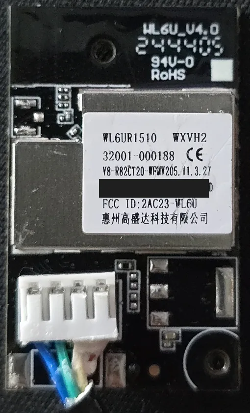
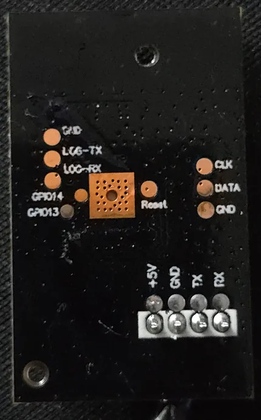

# TCL WL6U ESPHome — Original Module Firmware

The goal was local Home Assistant control without the TCL cloud. The ESPHome projects checked during research all replaced the original Wi-Fi module with an ESP32.

That seemed like a waste of a perfectly working chip. The original WL6U module already has a Realtek RTL8720CF that LibreTiny supports, so why not run ESPHome on that instead?

That's what this project does. It keeps the original module and replaces its firmware, so there's no replacement board to buy or fit inside the AC.

Tested on one TAC-12CHSD so far. Other models and revisions haven't been verified. Still experimental.

## Figuring out the original firmware

Started with a flash dump read directly from the original module. Reverse-engineered the stock code that builds commands for the AC and decodes its replies—not phone-app traffic. Checked selected functions in an emulator, then tested the replacement firmware on the AC.

That included the control table, status fields, temperature calculations, error bits, energy data and timer formats. The temperature decoding comes from the original firmware's calculations, not a guessed offset. Home Assistant also keeps the tenths of a degree present in the room-temperature data instead of dropping them like the stock report does.

The goal is access to what the AC actually sends, not just the settings and readings TCL chooses to show in its Wi-Fi app. This firmware exposes decoded controls and diagnostics, with optional raw fields and receive logs for the rest. Not every byte has a known meaning, and features found in the stock code aren't necessarily supported by the tested AC.

The [reverse-engineering notes](docs/REVERSE_ENGINEERING.md) cover the findings, exact temperature formulas and remaining unknowns. The stock dump and device credentials aren't included here.

## Module

WL6U_V4.0, front and back. Serial number redacted; photo metadata removed.

<a href="docs/images/wl6u-front.webp"></a>
<a href="docs/images/wl6u-back.webp"></a>

See the [annotated flashing-pad photo and wiring table](docs/FLASHING.md#2-wire-it-with-all-power-off) for programmer connections.

## Install

**[Flashing instructions](docs/FLASHING.md)** · **[Recovery](docs/RECOVERY.md)**

First installation requires a USB–UART adapter, a same-device backup and a deliberate bootloader/flash-layout migration. **Do not upload a generic ESPHome application over the stock firmware.** Full restoration of stock operation has not yet been tested.

Disconnect AC mains before removing or installing the module. Do all programming with the module completely disconnected from the appliance. Never attach USB or bench power to a module connected to the AC; low-voltage labels do not establish mains isolation.

This is for the WL6U_V4.0 module with an RTL8720CF and 2 MiB of flash. The stock firmware version doesn't need to match the analyzed dump; the preparation helper checks the flash layout and backup integrity instead.

The AC connection uses PA11 for TX and PA12 for RX at 9600 baud, 8E1. Programming and logs use the separate LOG pads with 3.3 V logic.

After installation, add the **ESPHome integration** in Home Assistant using the device's address and API encryption key.

## Controls

- Climate: off, auto, cool, dry, fan and heat; 16–31 °C in 0.5 °C steps.
- Fan, swing, louver position, Eco/Boost/Sleep presets.
- Display, beep, health, anti-mould, 3D airflow and light-sense switches.
- Room temperature, power, energy, AC-link and error diagnostics.

See [controls and limitations](docs/CONTROLS.md) for entity behavior, optional features and API actions. A delivered API call or TX log does not prove the AC accepted a command. Supply-voltage and compressor-frequency labels are inferred; physical louver labels have not been verified.

### Home Assistant updates and heartbeat

Entity states are sent to Home Assistant only when their values change, rather than repeating identical readings over Wi-Fi. This applies while the AC is running or off. Wired UART polling and local sensor sampling continue at their normal intervals; real changes are reported at the next sample. Connecting or reconnecting API clients still receive an initial state snapshot. API keepalives and any subscribed debug logs are separate traffic.

**AC Link is our AC-side heartbeat indicator.** It stays online while validated AC status replies are fresh and goes offline if no valid status has arrived for more than 10 seconds. It does not toggle or send a repeated heartbeat message for every reply. Use it to check that the AC is still answering even when temperatures and settings remain unchanged. Home Assistant's ESPHome connection availability separately indicates whether the module itself is reachable.

Two caveats:
- An unchanged entity's HA update timestamp can look old even though it is still being sampled; check AC Link and device availability instead.
- If deriving energy from the Power sensor with HA's [Integral helper](https://www.home-assistant.io/integrations/integration/), configure `max_sub_interval` for regular accumulation during constant power. The AC's separate energy-counter sensor does not require repeated identical readings.

## Build

From this repository's root, using Linux and Python 3.14:

```sh
python3.14 -m venv .venv-firmware
. .venv-firmware/bin/activate
python -m pip install -r requirements-firmware.txt
```

Create `firmware/secrets.yaml` from [the example](firmware/secrets.example.yaml), without overwriting an existing file. Set your Wi-Fi credentials, generate a fresh API encryption key, and generate separate random OTA and recovery-hotspot passwords using the commands in the example. For compile-only checks, use synthetic Wi-Fi values.

```sh
esphome compile firmware/tac-12chsd.yaml
```

Compilation does not install firmware. Builds embed credentials: keep secrets, binaries and build directories private. Use the [flashing guide](docs/FLASHING.md) for first installation and [OTA update instructions](docs/FLASHING.md#later-updates-over-wi-fi) for an already migrated device. Existing passwordless installations need the new `ota_password` secret. Migration to the password-protected firmware and a subsequent password-authenticated upload were verified on the tested unit; rejection of an incorrect password remains untested.

### Firmware configurations

Choose a controls profile for the migrated **WL6U / RTL8720CF** hardware:

- **[`firmware/tac-12chsd.yaml`](firmware/tac-12chsd.yaml):** entity selection tailored to the tested TAC-12CHSD. Everyday controls are enabled, optional diagnostics are disabled by default, and unsupported/extended entities are omitted.
- **[`firmware/all-fields.yaml`](firmware/all-fields.yaml):** community testing profile exposing all currently implemented entities, including other-model/extended fields and raw outdoor temperature. Optional entities are disabled by default; users choose which to enable in HA. It does **not** detect compatibility, decode every unknown byte, or make this firmware suitable for different Wi-Fi module hardware.

Both include shared controls, diagnostics, password-protected OTA and Wi-Fi recovery. See [profile selection and testing](docs/CONTROLS.md#firmware-profiles) before enabling unfamiliar controls. The old `ac-controls.yaml` entry point is now `tac-12chsd.yaml`. The ESPHome node is named `tcl-wl6u-ac` (formerly `wl6u-bench`); credentials remain unchanged.

If Wi-Fi cannot connect for one minute, join **WL6U Recovery** using `recovery_ap_password`, then open `http://192.168.4.1/` to enter the new network credentials. See [Wi-Fi recovery](docs/RECOVERY.md#wi-fi-recovery-hotspot). Hotspot connection, captive DNS, the recovery page and Wi-Fi reconfiguration were verified on the tested module.

For bench work, `firmware/bench.yaml` only enables Wi-Fi, the API and the LOG UART—no AC UART or OTA. `firmware/ac-debug.yaml` adds status polling and raw AC logs, but no controls or OTA.

`firmware/loopback.yaml` is a transmitting connector diagnostic. **Never connect it to the AC.**

## Development

Keep fixes focused and include the checks run in your pull request. Compatibility reports should name the exact AC/module revision and distinguish observed behavior from inference. Do not attach credentials, device dumps, compiled firmware or unredacted logs/photos. Keep API/OTA access on a trusted network; do not disclose sensitive findings in public issues.

Profile regression checks (using the build environment above):

```sh
python -m unittest discover -s tests -v
esphome compile firmware/tac-12chsd.yaml
esphome compile firmware/all-fields.yaml
```

These are offline checks, not hardware compatibility tests or uploads.

## Layout

- `firmware/` — ESPHome configurations, local component and codecs.
- `tools/` — offline installation preparation and explicit live API helper.
- `docs/` — flashing, recovery and control reference.

## License

Original code and documentation: **MIT OR Apache-2.0**; see [LICENSE](LICENSE). Dependencies retain their own terms. No vendor firmware, private backups or vendor documents are distributed here.
