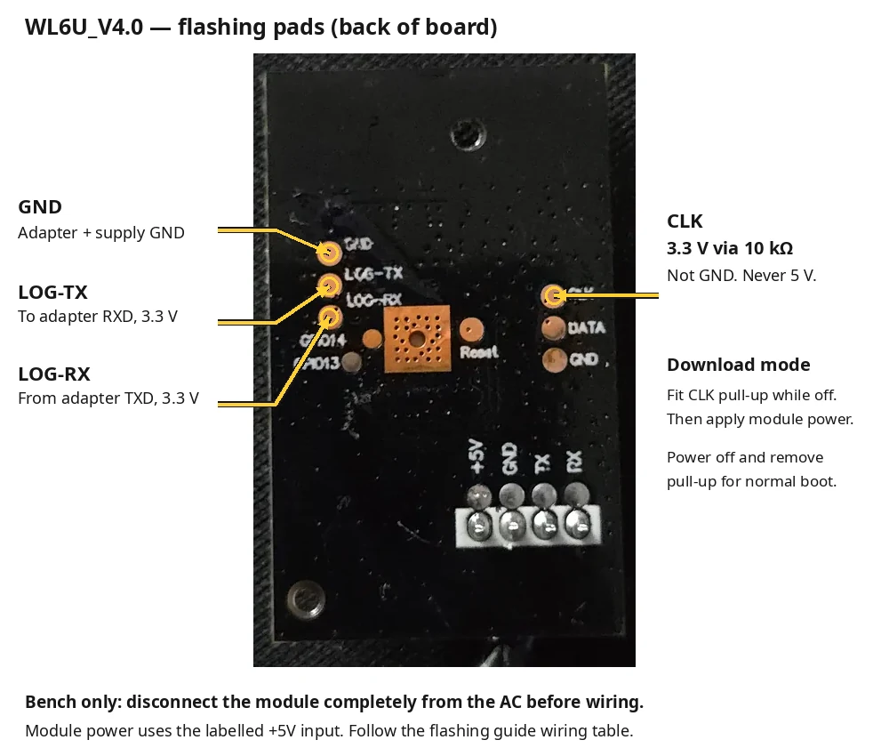

# Flash the original WL6U module

**Path:** identify → wire on the bench → back up twice → build → prepare → write/verify → boot → install in the AC.

Read [recovery](RECOVERY.md) **before** the first write. This guide is for **WL6U_V4.0 / RTL8720CF / 2 MiB**. The stock firmware version doesn't need to match the analyzed dump. One owner's migration and AC operation are recorded; this is not a universal TCL installer. The preparation helper checks the flash layout and backup integrity. Do not bypass those checks to force a different module through.

The five-region migration and later controls installation worked on one owner's unit. The helper below reproduces the region-preparation method, but is host-tested—not itself a hardware-tested installer. Full stock restoration remains untested.

## 1. Gather these first

- Original **WL6U_V4.0** module: label `WL6UR1510`, part number `32001-000188`, RTL8720CF with 2 MiB flash. Confirm the chip/security policy with the read-only command in step 3; a similar AC model name or PCB label alone is insufficient.
- CP2102 or equivalent USB–UART adapter with **verified 3.3 V TX/RX logic**.
- Stable, regulated **5 V supply for the module's labeled +5V input**, common ground, short secure wires, and a **10 kΩ resistor** for the boot strap. Do not power the module from an adapter's weak 3.3 V output.
- A verified 3.3 V reference for the strap; the owner's CP2102 3.3 V output was used for this resistor only. An adapter's voltage-select jumper may not select its UART logic voltage—verify it.
- Linux computer, `uv` ([installation](https://docs.astral.sh/uv/getting-started/installation/)), and enough private storage for several 2 MiB backups. This guide uses Bash/GNU tools.

**Unplug AC mains before removing the module. The module must be completely disconnected from the appliance during all bench/programmer work.** Never connect a PC/programmer/bench supply to a module still plugged into the AC. Low-voltage labels do not prove mains isolation. If you cannot positively identify the pads and supply, stop.

## 2. Wire it with all power off

Use the **LOG** pads, not the AC connector's TX/RX pins:



Back-of-board view, matching the labels on the tested WL6U_V4.0. The CLK connection is a temporary pull-up for download mode, not the module's power input. Follow the complete wiring table below, including the separate +5V supply.

| Connection | Module pad / input |
| --- | --- |
| USB–UART **TXD**, 3.3 V logic | **LOG-RX** |
| USB–UART **RXD** | **LOG-TX** |
| USB–UART GND and supply GND | **GND** |
| Regulated supply +5 V | Labeled **+5V** input |
| Verified 3.3 V → **10 kΩ resistor** | **CLK** |

Leave DATA, Reset, GPIO13/14 and adapter DTR/RTS unconnected. Do not ground GPIO13/PA13. Do not apply 5 V to LOG, CLK or any GPIO. Do not connect two power supplies to +5V. Wire orientation is determined by board labels, **not cable colors or a mirrored photo**.

```text
USB–UART TXD ───────────── LOG-RX
USB–UART RXD ───────────── LOG-TX
USB–UART GND ──┬───────── GND
5 V supply GND ┘
5 V supply + ───────────── +5V
verified 3.3 V ──[10 kΩ]── CLK   ← fitted only for download mode
```

**Enter download mode:** fit the CLK resistor while off, then apply module power. CLK is pulled **up to 3.3 V**, not down like an ESP boot pin. Power off and remove the resistor to return to normal boot. This arrangement was verified on the owner's board; it is not a direct continuity measurement of every board revision.

## 3. Set up tools and choose the actual port

From the project root:

```sh
uv venv .venv --python 3.14
uv pip install --python .venv/bin/python -r requirements-firmware.txt
. .venv/bin/activate
umask 077
ls -l /dev/serial/by-id/
PORT='/dev/serial/by-id/REPLACE_WITH_YOUR_ADAPTER'
# Private backups stay outside this repository.
mkdir -p ../backups
WORK="$(mktemp -d ../backups/install-XXXXXXXX)"
printf 'Keep this work-directory path: %s\n' "$WORK"
```

Keep using the **same terminal** so `PORT`, `WORK` and the functions below remain defined. Do not overwrite an existing work directory. Close all serial monitors before using ltchiptool. If you lack serial-port permissions, fix your distribution's serial-access group/session; do not use an auto-selected port or blindly run tools as root.

Start with the freshly powered download session:

```sh
LINK_BAUD=115200
ltchiptool flash info -d "$PORT" -B "$LINK_BAUD" -b 460800 -t 15 rtl8720c
```

**Stop unless it identifies RTL8720CF and Secure Boot: Disabled.** The recorded device was VID 5, version 3. Different identity/revision or unreadable policy needs review before writing. `flash info` reads eFuse through a temporary SRAM helper; it does not program eFuse. Its output contains MAC addresses: keep it private. Never burn fuses to make a device fit this guide.

After a successful connection, the downloader is now at 460800:

```sh
LINK_BAUD=460800
read_full() {
  ltchiptool flash read -d "$PORT" -B "$LINK_BAUD" -b 460800 -t 15 \
    -c -s 0 -l 0x200000 rtl8720c "$1"
}
```

If you power-cycle, enter download mode again and repeat the `flash info` step starting with `LINK_BAUD=115200`. The `-t 15` option is the **connection** timeout; a full read took about **four minutes**. Do not kill it after 15 seconds.

## 4. Back up twice—no writes yet

Choose new output paths; never reuse an existing backup filename. Run this block and require its final success message:

```sh
read_full "$WORK/stock.bin" && \
read_full "$WORK/stock-check.bin" && \
test "$(wc -c < "$WORK/stock.bin")" -eq 2097152 && \
test "$(wc -c < "$WORK/stock-check.bin")" -eq 2097152 && \
cmp "$WORK/stock.bin" "$WORK/stock-check.bin" && \
(cd "$WORK" && sha256sum stock.bin > stock.sha256) && \
echo 'Two full backups match. Make a separate secure copy before continuing.'
```

**Copy `stock.bin` and `stock.sha256` to a separate safe location now.** These must be from **this module**, before its first migration. They include device credentials/calibration and are not for public uploads. The SHA-256 will usually differ from the owner's: do not try to match someone else's whole-device hash. Keep the original stock backup forever, even after OTA starts working.

If reads fail, differ or are short, **stop** and use [connection troubleshooting](RECOVERY.md#cannot-connect-to-the-downloader). Do not flash to see whether it fixes a bad backup.

## 5. Build your firmware and prepare the five files (offline)

Create `firmware/secrets.yaml` from `firmware/secrets.example.yaml` **only if it does not already exist**. Set your own Wi-Fi credentials, generate a fresh API encryption key, and generate separate random `ota_password` and `recovery_ap_password` values using the commands in the example. If a local secrets file already exists, add the missing entry without replacing its other values. Never copy someone else's compiled image.

```sh
esphome compile firmware/tac-12chsd.yaml
BUILD='firmware/.esphome/build/wl6u-bench/.pioenvs/wl6u-bench'
python -m tools.prepare_install \
  --backup "$WORK/stock.bin" --build-dir "$BUILD" --output "$WORK/plan"
```

`wl6u-bench` is the inherited ESPHome node/build name for both `tac-12chsd.yaml` and `all-fields.yaml`; it is not a typo. This guide uses the tested TAC-12CHSD profile. For another AC model, review [profile selection](CONTROLS.md#firmware-profiles) before substituting `all-fields.yaml`. Compilation is not a flash operation. The pinned environment is ESPHome 2026.10.1, LibreTiny 1.14.0 and ltchiptool 4.15.0.

The helper **does not access hardware**. It checks the stock flash layout and backup integrity, generated image integrity, matching build parts and board regions. It creates sector-padded writes, `plan.json` and a 2 MiB `expected-full.bin`. It refuses an existing output directory. If preparation fails, stop—do not substitute another image or disable validation.

| Write order | File in `$WORK/plan` | Flash address | What changes |
| --- | --- | --- | --- |
| 1 | `01-application.bin` | `0x00C000` | ESPHome application; length calculated from your build |
| 2 | `02-ota2-header.bin` | `0x104000` | Blank new-layout OTA2 header |
| 3 | `03-kvs.bin` | `0x1FC000` | Blank the new 16 KiB settings area |
| 4 | `04-bootloader.bin` | `0x004000` | LibreTiny bootloader |
| 5 | `05-partition-table.bin` | `0x000000` | LibreTiny partition table |

The helper preserves `[0x1000, 0x4000)` and every byte outside these writes in its expected image. Some TCL configuration/userdata is **deliberately overwritten**, not preserved for stock operation; recovery needs the original backup. Do not flash `image_flash_is.0x000000.bin` as one complete image: its generated system data differs from the device's. Do not use serial UF2 auto-flashing here: it can auto-boot before the required full readback.

## 6. Write, then verify before booting

**This block writes flash and replaces the stock bootloader/layout.** Continue only after the separate backup copy, correct chip/security check and successful preparation above. Keep the module off the AC, the CLK strap fitted and power stable. Do not boot between writes.

The fresh pre-write read must still match the backup. If it does not, the `&&` chain stops—do not update the baseline just to continue.

```sh
write_part() {
  ltchiptool flash write -d "$PORT" -B "$LINK_BAUD" -b 460800 -t 15 \
    -c -f rtl8720c -s "$2" -S 0 -l "$(wc -c < "$1")" "$1"
}

read_full "$WORK/preflash.bin" && \
cmp "$WORK/stock.bin" "$WORK/preflash.bin" && \
write_part "$WORK/plan/01-application.bin"     0x00C000 && \
write_part "$WORK/plan/02-ota2-header.bin"     0x104000 && \
write_part "$WORK/plan/03-kvs.bin"             0x1FC000 && \
write_part "$WORK/plan/04-bootloader.bin"      0x004000 && \
write_part "$WORK/plan/05-partition-table.bin" 0x000000 && \
read_full "$WORK/postflash.bin" && \
cmp "$WORK/plan/expected-full.bin" "$WORK/postflash.bin" && \
echo 'Full pre-boot readback matches. Power off before removing the CLK strap.'
```

Every write uses device hash checking; the last comparison checks **all 2 MiB**, including untouched regions. No final success message means **stop and keep the files**. Do not reconnect the AC or blindly retry. See [interrupted/failed writes](RECOVERY.md#write-failed-or-power-was-lost).

## 7. First boot on the bench

1. Power the module off. Remove the CLK resistor. For receive-only monitoring, disconnect adapter TXD from LOG-RX **while off**; keep adapter RXD connected to LOG-TX and common ground.
2. Open a 115200 8N1 log monitor, then restore module power:

   ```sh
   python -m serial.tools.miniterm "$PORT" 115200 --dtr 0 --rts 0
   ```

   Exit with **Ctrl+]**. Do not type device commands. Look for LibreTiny, ESPHome, `setup() finished successfully!` and Wi-Fi connection. The log is private. Runtime settings writes mean flash is no longer expected to match the pre-boot image exactly.
3. Check encrypted API logs over Wi-Fi with your device's actual DHCP address:

   ```sh
   esphome logs firmware/tac-12chsd.yaml --device YOUR_DEVICE_IP
   ```

4. Hardware UART0 should report TX PA11 / RX PA12, 9600 8E1 without a failed component. **No AC replies on the disconnected bench is normal.** Do not use the transmitting `loopback.yaml` image in the appliance.

If it cannot boot/join the network, keep it on the bench and follow [recovery](RECOVERY.md). Do not use AC installation as a diagnostic step.

## 8. Install in the AC and add Home Assistant

Power off both AC mains and bench power. Disconnect **every USB/programmer/supply/strap/jumper wire**, reinstall the module in its original socket and close the enclosure before restoring mains. Use Wi-Fi logs only; do not handle or probe an energized open AC.

In Home Assistant add **ESPHome**, enter the module's address and its API encryption key. Check the AC-link entity and actual status replies before commanding the appliance. API delivery/TX logs alone do not prove acceptance. See [controls and limitations](CONTROLS.md).

## Later updates over Wi-Fi

Both controls profiles (`tac-12chsd.yaml` and `all-fields.yaml`) enable OTA; stock firmware and the bench/debug/loopback targets do not. Build and upload with the known-good configuration and your actual IP:

```sh
esphome compile firmware/tac-12chsd.yaml && \
esphome upload firmware/tac-12chsd.yaml --device YOUR_DEVICE_IP
```

Keep the same API key, OTA password and local settings unless intentionally changing them. Save the working source/configuration and private build artifacts before updating. Do not perform a first stock-to-LibreTiny migration by OTA.

**Existing passwordless installations:** add a fresh random `ota_password` to your existing local secrets before compiling. The upload above sends the newly password-protected image to the old server, which does not request password authentication. Subsequent uploads must use the new password. This migration was verified on the tested TAC-12CHSD on 2026-10-28: the updated firmware reconnected through the encrypted API and received AC status and energy replies. A subsequent password-authenticated upload was also verified on the same unit. Rejection of an incorrect password remains untested. Keep serial recovery available and verify the running firmware after updating.

**Existing password-protected installations:** retain their current OTA password. Do not simply replace it before uploading: upload authentication must match the running firmware. For intentional rotation, follow [ESPHome's password-change procedure](https://esphome.io/components/ota/esphome/#changing-an-existing-password) or plan a serial recovery/reinstallation rather than improvising a bypass.

After deployment, verify a subsequent authenticated update and rejection of an incorrect password before claiming OTA authentication is device-validated. Do not test against devices you do not own. Restrict access to trusted management hosts; encrypted API access does not protect password-based OTA. Keep credentials and logs private; never expose the API or OTA endpoint to the internet. If OTA fails but the module still runs, retry only after diagnosing the error. If it no longer runs, use [serial recovery](RECOVERY.md), not a remote factory reset.
